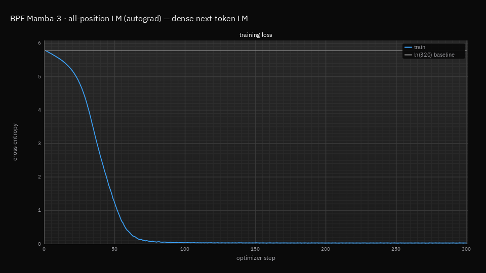

# tu_nlp_bpe_mamba3 — BPE × Mamba-3

The BPE-tokenizer × Mamba-3 cell of the
[NLP tutorial matrix](../README.md) — same 576-character corpus, same
300-step recipe and captured training lifecycle. This entry selects
the tokenizer and model shown below. See
[`tu_nlp_char_rnn`](../tu_nlp_char_rnn/tu_nlp_char_rnn.md) for the full
walkthrough.

## This cell

| | |
| --- | --- |
| Tokenizer | the 320-token learned BPE vocabulary (`BpeTokenizer`/`BpeSampler`: 256 bytes + 64 merges) — merges collapse the corpus into short predictable runs, which is why BPE rows reach ~0.02 loss |
| Model | `BPE Embedding → Mamba-3(32,state=32,expand=2) + residual → Linear` |
| Parameters | 29,960 |
| Optimizer | AdamW(lr=0.003) — lower rate for the Mamba-3/Empyrealm family |

The loop is a `prepare`/`record` pair per step — `GradientTape` → `cross_entropy` → `backward` → AdamW —
driven by `oa.ml.ItTraining`, so the whole run is one captured GPU program replayed
299 times (34 nodes for this model).

## Measured — Surface Laptop 5 (ADL GT2)



Canonical 300-step training loss, recorded by this tutorial.

| Loss init→final | Accuracy | Program nodes | Wall ms/step | Token/s |
| --- | --- | --- | --- | --- |
| 5.775→0.020 | 98.9% | 34 | 12.23 | 83.7K |

Reference generation on the default recipe (asserted by the tutorial):

```text
prompt:    "to be"
generated: "to beion wher tis nobler in the mind to suffer the slings and arrows of outrageous fo"
```

## Run

```bash
python3 sdk/py/tutorials/ml/nlp/tu_nlp_bpe_mamba3/tu_nlp_bpe_mamba3.py
```

Regenerate the training-loss image from the repository root:

```bash
python3 sdk/py/tutorials/ml/nlp/tu_nlp_bpe_mamba3/tu_nlp_bpe_mamba3.py --plot sdk/py/tutorials/ml/nlp/tu_nlp_bpe_mamba3/asset/training-curve.png
```

On the default recipe the tutorial self-tests: loss regime, accuracy
floor, exact reference generation, and `.oam` checkpoint round-trip.

## Terminal output

Recorded canonical 300-step run on Intel Iris Xe (ADL GT2), Mesa 26.2.7.
Startup logs, intermediate progress updates and the plot-save path are
omitted. Timings vary by run; these are not new benchmark baselines.

```console
╔══════════════════════════════════════════════════════════════════╗
║  OA Tutorial — BPE Mamba-3 · all-position LM (autograd)        ║
╚══════════════════════════════════════════════════════════════════╝

tokenizer: byte BPE · vocab=320 (256 bytes + 64 merges)
compression: 576 bytes → 210 tokens · 2.743 byte/token · 63.5% fewer positions
context coverage: 16 BPE tokens ≈ 43.9 source bytes at corpus average
Task: dense next-token prediction at every position

Model: BPE Embedding → Mamba-3(32,state=32,expand=2) + residual → Linear
params: 29960    Optimizer: AdamW(lr=0.003)


  300/300 |██████████| 3.82s · 12.73 ms/step · 5.03K sample/s · 80.44K BPE token/s · 223.27K byte/s · loss: 0.0200

Summary:
  loss: initial 5.774934 · final 0.020031 · mean 0.748239
  Wall: 12.73 ms/step · 5.03K sample/s · 80.43K BPE token/s · 223.24K byte/s
  GPU (bpe_mamba3_training_step): mean 9.468 ms/step · p50 7.556 · p95 15.408 · min 7.166 · max 19.185 · 6.76K sample/s · 108.15K BPE token/s · 300.18K byte/s · wall-GPU gap 26%
  run: 3.82s · 300 steps · batch 64 · sequence 16 BPE token/sample

Evaluation:
  Random-loss baseline ln(320) = 5.7683
  final batch: 2.771 byte/token · 0.0104 bits/byte
  BPE-token accuracy: 98.9%
  post-update evaluation loss: 0.019415

Generation:
  prompt: "to be"
  generated: "to beion wher tis nobler in the mind to suffer the slings and arrows of outrageous fo"
program: 34 nodes · 1 recording · 299 cache hits · 0 uploads
```

## Source

- [`tu_nlp_bpe_mamba3.py`](./tu_nlp_bpe_mamba3.py)
- Shared training loop: [`../_nlp_common.py`](../_nlp_common.py)
- [Suite README](../README.md)
- Rust peer: [`sdk/rs/tutorials/ml/nlp/tu_nlp_bpe_mamba3`](../../../../../rs/tutorials/ml/nlp/tu_nlp_bpe_mamba3/tu_nlp_bpe_mamba3.md)
