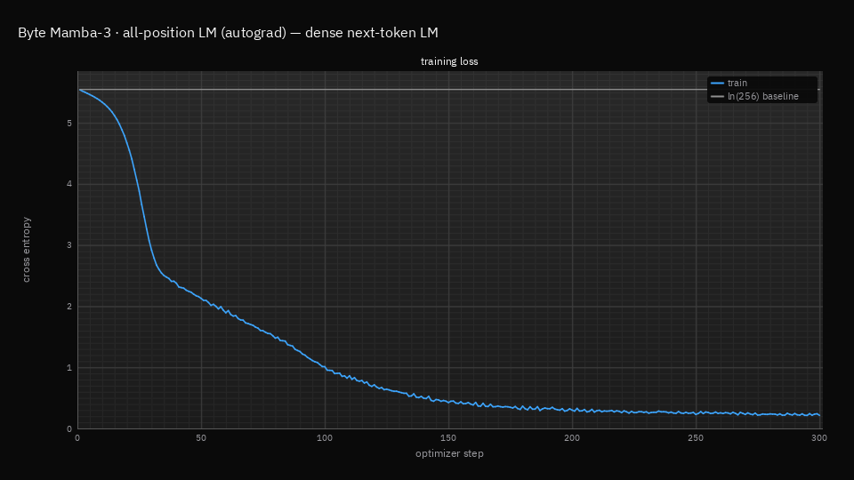

# tu_nlp_byte_mamba3 — Byte × Mamba-3

The byte-tokenizer × Mamba-3 cell of the
[NLP tutorial matrix](../README.md) — same 576-character corpus, same
300-step recipe and captured training lifecycle. This entry selects
the tokenizer and model shown below. See
[`tu_nlp_char_rnn`](../tu_nlp_char_rnn/tu_nlp_char_rnn.md) for the full
walkthrough.

## This cell

| | |
| --- | --- |
| Tokenizer | the 256-token packed-U8 byte vocabulary (`ByteSampler`) — one token per source byte |
| Model | `Byte Embedding → Mamba-3(32,state=32,expand=2) + residual → Linear(32→256)` |
| Parameters | 25,800 |
| Optimizer | AdamW(lr=0.003) — lower rate for the Mamba-3/Empyrealm family |

The loop is a `prepare`/`record` pair per step — `GradientTape` → `cross_entropy` → `backward` → AdamW —
driven by `oa.ml.ItTraining`, so the whole run is one captured GPU program replayed
299 times (34 nodes for this model).

## Measured — Surface Laptop 5 (ADL GT2)



Canonical 300-step training loss, recorded by this tutorial.

| Loss init→final | Accuracy | Program nodes | Wall ms/step | Token/s |
| --- | --- | --- | --- | --- |
| 5.539→0.214 | 93.0% | 34 | 11.68 | 87.7K |

Reference generation on the default recipe (asserted by the tutorial):

```text
prompt:    "to be"
generated: "to be that is the question whether tis nobler in the mind to suffer the slings and ar"
```

## Run

```bash
python3 sdk/py/tutorials/ml/nlp/tu_nlp_byte_mamba3/tu_nlp_byte_mamba3.py
```

Regenerate the training-loss image from the repository root:

```bash
python3 sdk/py/tutorials/ml/nlp/tu_nlp_byte_mamba3/tu_nlp_byte_mamba3.py --plot sdk/py/tutorials/ml/nlp/tu_nlp_byte_mamba3/asset/training-curve.png
```

On the default recipe the tutorial self-tests: loss regime, accuracy
floor, exact reference generation, and `.oam` checkpoint round-trip.

## Terminal output

Recorded canonical 300-step run on Intel Iris Xe (ADL GT2), Mesa 26.2.7.
Startup logs, intermediate progress updates and the plot-save path are
omitted. Timings vary by run; these are not new benchmark baselines.

```console
╔══════════════════════════════════════════════════════════════════╗
║  OA Tutorial — Byte Mamba-3 · all-position LM (autograd)       ║
╚══════════════════════════════════════════════════════════════════╝

tokenizer: raw bytes · vocab=256
Task: dense next-byte prediction at every position

Model: Byte Embedding → Mamba-3(32,state=32,expand=2) + residual → Linear(32→256)
params: 25800    Optimizer: AdamW(lr=0.003)


  300/300 |██████████| 3.64s · 12.13 ms/step · 5.28K sample/s · 84.43K byte token/s · 84.43K byte/s · loss: 0.2143

Summary:
  loss: initial 5.539418 · final 0.214324 · mean 1.149250
  Wall: 12.13 ms/step · 5.28K sample/s · 84.41K byte token/s · 84.41K byte/s
  GPU (byte_mamba3_training_step): mean 9.746 ms/step · p50 7.958 · p95 16.150 · min 6.985 · max 17.901 · 6.57K sample/s · 105.07K byte token/s · 105.07K byte/s · wall-GPU gap 20%
  run: 3.64s · 300 steps · batch 64 · sequence 16 byte token/sample

Evaluation:
  Random-loss baseline ln(256) = 5.5452
  byte-token accuracy: 93.0%
  post-update evaluation loss: 0.207903

Generation:
  prompt: "to be"
  generated: "to be that is the question whether tis nobler in the mind to suffer the slings and ar"
program: 34 nodes · 1 recording · 299 cache hits · 0 uploads
checkpoint: optimizer step, accuracy, and exact generation restored
```

## Source

- [`tu_nlp_byte_mamba3.py`](./tu_nlp_byte_mamba3.py)
- Shared training loop: [`../_nlp_common.py`](../_nlp_common.py)
- [Suite README](../README.md)
- Rust peer: [`sdk/rs/tutorials/ml/nlp/tu_nlp_byte_mamba3`](../../../../../rs/tutorials/ml/nlp/tu_nlp_byte_mamba3/tu_nlp_byte_mamba3.md)
