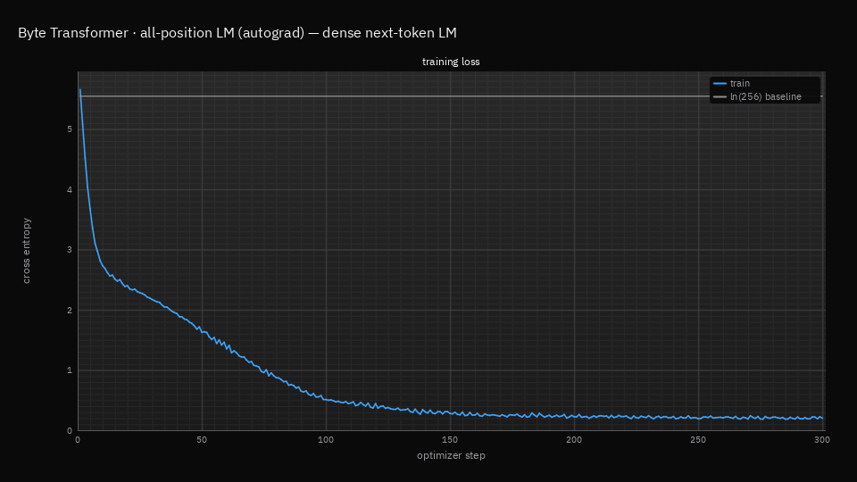

# tu_nlp_byte_transformer — Byte × Transformer

The byte-tokenizer × Transformer cell of the
[NLP tutorial matrix](../README.md) — same 576-character corpus, same
300-step recipe and captured training lifecycle. This entry selects
the tokenizer and model shown below. See
[`tu_nlp_char_rnn`](../tu_nlp_char_rnn/tu_nlp_char_rnn.md) for the full
walkthrough.

## This cell

| | |
| --- | --- |
| Tokenizer | the 256-token packed-U8 byte vocabulary (`ByteSampler`) — one token per source byte |
| Model | `Byte + position Embedding → Transformer(32,64) → LN → Linear(32→256)` |
| Parameters | 25,760 |
| Optimizer | AdamW(lr=0.01) — the canonical recipe |

The loop is a `prepare`/`record` pair per step — `GradientTape` → `cross_entropy` → `backward` → AdamW —
driven by `oa.ml.ItTraining`, so the whole run is one captured GPU program replayed
299 times (46 nodes for this model).

## Measured — Surface Laptop 5 (ADL GT2)



Canonical 300-step training loss, recorded by this tutorial.

| Loss init→final | Accuracy | Program nodes | Wall ms/step | Token/s |
| --- | --- | --- | --- | --- |
| 5.657→0.201 | 92.9% | 46 | 7.85 | 130.5K |

Reference generation on the default recipe (asserted by the tutorial):

```text
prompt:    "to be"
generated: "to be that is the question whether tis nobler in the mind to suffer the slings and ar"
```

## Run

```bash
python3 sdk/py/tutorials/ml/nlp/tu_nlp_byte_transformer/tu_nlp_byte_transformer.py
```

Regenerate the training-loss image from the repository root:

```bash
python3 sdk/py/tutorials/ml/nlp/tu_nlp_byte_transformer/tu_nlp_byte_transformer.py --plot sdk/py/tutorials/ml/nlp/tu_nlp_byte_transformer/asset/training-curve.png
```

On the default recipe the tutorial self-tests: loss regime, accuracy
floor, exact reference generation, and `.oam` checkpoint round-trip.

## Terminal output

Recorded canonical 300-step run on Intel Iris Xe (ADL GT2), Mesa 26.2.7.
Startup logs, intermediate progress updates and the plot-save path are
omitted. Timings vary by run; these are not new benchmark baselines.

```console
╔══════════════════════════════════════════════════════════════════╗
║  OA Tutorial — Byte Transformer · all-position LM (autograd)   ║
╚══════════════════════════════════════════════════════════════════╝

tokenizer: raw bytes · vocab=256
Task: dense next-byte prediction at every position

Model: Byte + position Embedding → Transformer(32,64) → LN → Linear(32→256)
params: 25760    Optimizer: AdamW(lr=0.01)


  300/300 |██████████| 2.56s · 8.54 ms/step · 7.50K sample/s · 119.95K byte token/s · 119.95K byte/s · loss: 0.2005

Summary:
  loss: initial 5.656755 · final 0.200502 · mean 0.756808
  Wall: 8.54 ms/step · 7.49K sample/s · 119.91K byte token/s · 119.91K byte/s
  GPU (byte_transformer_training_step): mean 6.504 ms/step · p50 4.899 · p95 13.551 · min 4.092 · max 15.606 · 9.84K sample/s · 157.45K byte token/s · 157.45K byte/s · wall-GPU gap 24%
  run: 2.56s · 300 steps · batch 64 · sequence 16 byte token/sample

Evaluation:
  Random-loss baseline ln(256) = 5.5452
  byte-token accuracy: 92.9%
  post-update evaluation loss: 0.190566

Generation:
  prompt: "to be"
  generated: "to be that is the question whether tis nobler in the mind to suffer the slings and ar"
program: 46 nodes · 1 recording · 299 cache hits · 0 uploads
checkpoint: optimizer step, accuracy, and exact generation restored
```

## Source

- [`tu_nlp_byte_transformer.py`](./tu_nlp_byte_transformer.py)
- Shared training loop: [`../_nlp_common.py`](../_nlp_common.py)
- [Suite README](../README.md)
- Rust peer: [`sdk/rs/tutorials/ml/nlp/tu_nlp_byte_transformer`](../../../../../rs/tutorials/ml/nlp/tu_nlp_byte_transformer/tu_nlp_byte_transformer.md)
