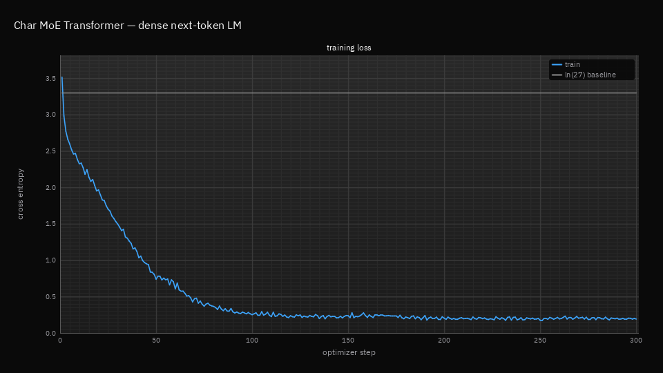

# tu_nlp_char_moe_transformer — Character × sparse MoE Transformer

The character-tokenizer × sparse MoE Transformer cell of the
[NLP tutorial matrix](../README.md) — same 576-character corpus, same
300-step recipe and captured training lifecycle. This entry selects
the tokenizer and model shown below. See
[`tu_nlp_char_rnn`](../tu_nlp_char_rnn/tu_nlp_char_rnn.md) for the full
walkthrough.

## This cell

| | |
| --- | --- |
| Tokenizer | the 27-token character vocabulary (`CharSampler`) — accuracy is comparable within Char rows only |
| Model | `token+position embedding → attention → sparse MoE(E=4,K=2,DFF=16) → LayerNorm → Linear` |
| Parameters | 13,183 |
| Optimizer | AdamW(lr=0.01) — the canonical recipe |

The loop is a `prepare`/`record` pair per step — `GradientTape` → `cross_entropy` → `backward` → AdamW —
driven by `oa.ml.ItTraining`, so the whole run is one captured GPU program replayed
299 times (62 nodes for this model).

## Measured — Surface Laptop 5 (ADL GT2)



Canonical 300-step training loss, recorded by this tutorial.

| Loss init→final | Accuracy | Program nodes | Wall ms/step | Token/s |
| --- | --- | --- | --- | --- |
| 3.514→0.190 | 92.6% | 62 | 8.41 | 121.8K |

Reference generation on the default recipe (asserted by the tutorial):

```text
prompt:    "to be"
generated: "to be that is the question whether tis nobler in the mind to suffer the slings and ar"
```

## Run

```bash
python3 sdk/py/tutorials/ml/nlp/tu_nlp_char_moe_transformer/tu_nlp_char_moe_transformer.py
# render the loss curve into asset/
python3 sdk/py/tutorials/ml/nlp/tu_nlp_char_moe_transformer/tu_nlp_char_moe_transformer.py --plot sdk/py/tutorials/ml/nlp/tu_nlp_char_moe_transformer/asset/training-curve.png
```

On the default recipe the tutorial self-tests: loss regime, accuracy
floor, exact reference generation, and `.oam` checkpoint round-trip.

## Terminal output

Recorded canonical 300-step run on Intel Iris Xe (ADL GT2), Mesa 26.2.7.
Startup logs, intermediate progress updates and the plot-save path are
omitted. Timings vary by run; these are not new benchmark baselines.

```console
╔══════════════════════════════════════════════════════════════════╗
║  OA Tutorial — Char MoE Transformer · all-position LM           ║
╚══════════════════════════════════════════════════════════════════╝

tokenizer: character · vocab=27 (a-z + space)
Task: dense next-character prediction at every position

Model: token+position embedding → attention → sparse MoE(E=4, K=2, DFF=16) → LayerNorm → Linear
params: 13183    Optimizer: AdamW(lr=0.01)

training: 300 steps · batch=64 · sequence=16 character tokens

  300/300 |██████████| 6.63s · 22.10 ms/step · 2.90K sample/s · 46.33K token/s · loss: 0.1904

Summary:
  loss: initial 3.514067 · final 0.190367 · mean 0.506875
  Wall: 22.10 ms/step · 2.90K sample/s · 46.33K token/s
  GPU (char_moe_transformer_training_step): mean 17.382 ms/step · p50 15.960 · p95 24.038 · min 4.822 · max 25.795 · 3.68K sample/s · 58.91K token/s · wall-GPU gap 21%
  run: 6.63s · 300 steps · batch 64 · sequence 16 token/sample

Evaluation:
  Random-loss baseline ln(27) = 3.2958
  loss: evaluation 0.183673 · last training 0.190367
  character-token accuracy: 92.6%

Generation:
  prompt: "to be"
  generated: "to be that is the question whether tis nobler in the mind to suffer the slings and ar"
program: 62 nodes · 1 recording · 299 cache hits · 0 uploads
```

## Source

- [`tu_nlp_char_moe_transformer.py`](./tu_nlp_char_moe_transformer.py)
- Shared training loop: [`../_nlp_common.py`](../_nlp_common.py)
- [Suite README](../README.md)
- Rust peer: [`sdk/rs/tutorials/ml/nlp/tu_nlp_char_moe_transformer`](../../../../../rs/tutorials/ml/nlp/tu_nlp_char_moe_transformer/tu_nlp_char_moe_transformer.md)
