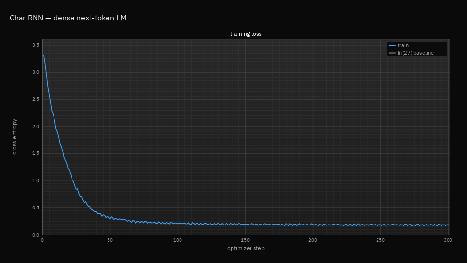

# tu_nlp_char_rnn — Character-level RNN text generation

Train a small recurrent language model on OA's GPU engine and generate
text. The model reads a 576-character teaching corpus, learns to predict
the next character at every position, and after 300 optimizer steps
generates a fixed 80-character continuation from a short prompt — the same genre
as the classic TensorFlow *text generation* tutorial, driven end-to-end
through `oa.ml` autograd. Mirrors the
[Rust tutorial](../../../../../rs/tutorials/ml/nlp/tu_nlp_char_rnn/tu_nlp_char_rnn.md).

## What this tutorial covers

- Character tokenization and a deterministic dense sampler
- `Embedding` → `RNN` → `Linear` model composition
- Training with `oa.ml.ItTraining`, `GradientTape`, and `AdamW`
- Whole-program capture: one recorded step replayed 299 times
- Checkpoint save/reload with exact optimizer and generation state
- Rendering the training curve through `oa.plot`

## The data

The corpus repeats this 192-character Hamlet excerpt three times, for
576 characters total (including spaces). The displayed line breaks are
spaces in the input:

```text
to be or not to be that is the question whether tis nobler in the mind
to suffer the slings and arrows of outrageous fortune or to take arms
against a sea of troubles and by opposing end them
```

The character vocabulary is `a-z` plus space — 27 tokens. Each training
sample is a window of 16 consecutive characters; the target is the same
window shifted one position left, so the model makes a prediction at
*every* position rather than only at the end. `nlp.CharSampler` draws
`batch=64` windows per step at deterministic offsets, which is why every
run uses the same training windows. Exact reference output is checked
on the qualified device; this is not a cross-device bitwise guarantee.

## The model

| Stage | Shape | Role |
| --- | --- | --- |
| `Embedding` | 27 → 32 | per-character dense features |
| `RNN` (Elman) | 32 → 64 hidden | sequential context |
| `Linear` | 64 → 27 | next-character logits |

8,891 parameters total. `nlp.CharRnn(engine)` owns the parameters as
device `Matrix` values; `model.forward(input)` returns logits for all
16 positions of all 64 sequences in the batch.

## The training loop

Each step is a prepare/record pair handed to `ItTraining`, which owns
batching, metrics, GPU timing, and the captured-step lifecycle:

```python
def record(prepared):
    input_matrix, target = prepared
    with oa.ml.GradientTape() as tape:
        logits = model.forward(input_matrix)
        loss = oa.ml.loss.cross_entropy(logits, target)
        tape.backward(loss)
    return loss

assert training.step(prepare, record)
```

The `GradientTape` records the forward graph; `backward` walks it and
`AdamW` consumes the gradients. Because the step shape never changes,
`ItTraining` records the program once and replays it — the run summary
reports `19 nodes · 1 recording · 299 cache hits`, i.e. the whole
training loop is one captured GPU program replayed 299 times.

## Results



Measured on a real 300-step run (Intel Iris Xe, ADL GT2):

| Metric | Value |
| --- | --- |
| Initial loss | 3.311 (random baseline ln(27) = 3.296) |
| Final loss | 0.186 |
| Character accuracy | 92.5% |
| Wall time | ~2.0 s · 6.8 ms/step · ~150K token/s |
| Program | 19 nodes · 1 recording · 299 cache hits |

The Python and Rust runs use the same loss/accuracy tolerance gates and
exact generation reference. Both bindings drive the same engine.
Greedy generation from the fixed prompt is:

```text
prompt:    "to be"
generated: "to be that is the question whether tis nobler in the mind
            to suffer the slings and ar"
```

The model has essentially memorized the periodic corpus — the point of
the tutorial is the pipeline, not generalization.

## Checkpointing

The tutorial finishes by exercising the `.oam` native checkpoint codec:
`oa.ml.save_checkpoint` serializes parameters and optimizer state, a
fresh model reloads them, and the code asserts identical optimizer step
count, identical accuracy, and byte-identical greedy output.

## Run

```bash
python3 sdk/py/tutorials/ml/nlp/tu_nlp_char_rnn/tu_nlp_char_rnn.py
python3 sdk/py/tutorials/ml/nlp/tu_nlp_char_rnn/tu_nlp_char_rnn.py --steps 300 --batch 64 --lr 0.01
```

Regenerate the training curve into `asset/`:

```bash
python3 sdk/py/tutorials/ml/nlp/tu_nlp_char_rnn/tu_nlp_char_rnn.py \
    --plot sdk/py/tutorials/ml/nlp/tu_nlp_char_rnn/asset/training-curve.png
```

On the default recipe the tutorial is also a self-test: it asserts the
loss regime, ≥90% accuracy, and the exact reference generation.

## Where to go next

The same workload runs across the 5×3 model/tokenizer matrix — swap the
model for [`tu_nlp_char_gru`](../tu_nlp_char_gru/tu_nlp_char_gru.md),
[`tu_nlp_char_transformer`](../tu_nlp_char_transformer/tu_nlp_char_transformer.md),
or [`tu_nlp_char_mamba3`](../tu_nlp_char_mamba3/tu_nlp_char_mamba3.md), or
switch the tokenizer to packed bytes
([`tu_nlp_byte_rnn`](../tu_nlp_byte_rnn/tu_nlp_byte_rnn.md)) or learned BPE
([`tu_nlp_bpe_rnn`](../tu_nlp_bpe_rnn/tu_nlp_bpe_rnn.md)) for the byte/token
comparison.

## Terminal output

Recorded canonical 300-step run on Intel Iris Xe (ADL GT2), Mesa 26.2.7.
Startup logs, intermediate progress updates and the plot-save path are
omitted. Timings vary by run; these are not new benchmark baselines.

```console
╔══════════════════════════════════════════════════════════════════╗
║  OA Tutorial — Char RNN · all-position LM (autograd)             ║
╚══════════════════════════════════════════════════════════════════╝

tokenizer: character · vocab=27 (a-z + space)
Task: dense next-character prediction at every position

Model: Embedding(32) → RNN(64) → Linear(27)
params: 8891    Optimizer: AdamW(lr=0.01)

training: 300 steps · batch=64 · sequence=16 character tokens

  300/300 |██████████| 4.04s · 13.45 ms/step · 4.76K sample/s · 76.12K token/s · loss: 0.1858

Summary:
  loss: initial 3.310753 · final 0.185840 · mean 0.359316
  Wall: 13.45 ms/step · 4.76K sample/s · 76.11K token/s
  GPU (char_rnn_training_step): mean 9.095 ms/step · p50 8.513 · p95 16.679 · min 3.129 · max 20.200 · 7.04K sample/s · 112.58K token/s · wall-GPU gap 32%
  run: 4.04s · 300 steps · batch 64 · sequence 16 token/sample

Evaluation:
  Random-loss baseline ln(27) = 3.2958
  character-token accuracy: 92.5% (compare within Char only)

Generation:
  prompt: "to be"
  generated: "to be that is the question whether tis nobler in the mind to suffer the slings and ar"
program: 19 nodes · 1 recording · 299 cache hits · 0 uploads
```

## Source

- [`tu_nlp_char_rnn.py`](./tu_nlp_char_rnn.py)
- Shared training loop: [`../_nlp_common.py`](../_nlp_common.py)
- Workload constants: `oa.ml.nlp` (mirrors `sdk/rs/lib/ml/nlp.rs`)
