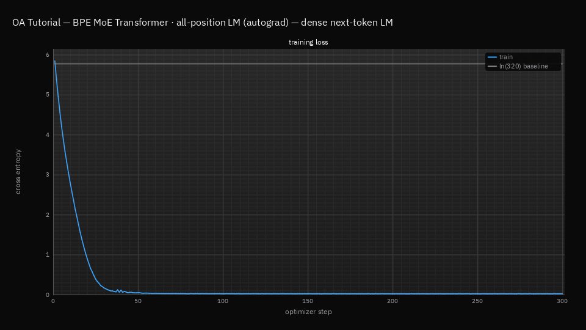

# tu_nlp_bpe_moe — BPE × sparse MoE Transformer

The BPE-tokenizer × sparse MoE Transformer cell of the
[NLP tutorial matrix](../README.md) — same 576-character corpus, same
300-step recipe and captured training lifecycle. This entry selects
the tokenizer and model shown below. See
[`tu_nlp_char_rnn`](../tu_nlp_char_rnn/tu_nlp_char_rnn.md) for the full
walkthrough.

## This cell

| | |
| --- | --- |
| Tokenizer | the 320-token learned BPE vocabulary (`BpeTokenizer`/`BpeSampler`: 256 bytes + 64 merges) — merges collapse the corpus into short predictable runs, which is why BPE rows reach ~0.02 loss |
| Model | `BPE + position Embedding → Attention + MoE(E=4,K=2,DFF=16) → LN → Linear` |
| Parameters | 32,228 |
| Optimizer | AdamW(lr=0.01) — the canonical recipe |

The loop is a prepare/record pair per step — `GradientTape` → `cross_entropy` → `backward` → AdamW —
driven by `oa::ml::ItTraining`, so the whole run is one captured GPU program replayed
299 times (62 nodes for this model).

## Measured — Surface Laptop 5 (ADL GT2)



Canonical 300-step training loss, recorded by this tutorial.

| Loss init→final | Accuracy | Program nodes | Wall ms/step | Token/s |
| --- | --- | --- | --- | --- |
| 5.844→0.020 | 98.8% | 62 | 10.43 | 98.2K |

Reference generation on the default recipe (asserted by the tutorial):

```text
prompt:    "to be"
generated: "to bee or not to be that is the question whether tis nobler in the mind to suffer the"
```

## Run

```bash
cargo run --release -p sdk --example tu_nlp_bpe_moe
```

Regenerate the training-loss image from the repository root:

```bash
cargo run --release -p sdk --example tu_nlp_bpe_moe -- --plot sdk/rs/tutorials/ml/nlp/tu_nlp_bpe_moe/asset/training-curve.png
```

On the default recipe the tutorial self-tests: loss regime, accuracy
floor, exact reference generation, and `.oam` checkpoint round-trip.

## Terminal output

Recorded canonical 300-step run on Intel Iris Xe (ADL GT2), Mesa 26.2.7.
Startup logs, intermediate progress updates and the plot-save path are
omitted. Timings vary by run; these are not new benchmark baselines.

```console
╔══════════════════════════════════════════════════════════════════╗
║  OA Tutorial — BPE MoE Transformer · all-position LM (autograd)║
╚══════════════════════════════════════════════════════════════════╝

tokenizer: byte BPE · vocab=320 (256 bytes + 64 merges)
compression: 576 bytes → 210 tokens · 2.743 byte/token · 63.5% fewer positions
context coverage: 16 BPE tokens ≈ 43.9 source bytes at corpus average
Task: dense next-token prediction at every position

Model: BPE + position Embedding → Attention + MoE(E=4,K=2,DFF=16) → LN → Linear
params: 32228    Optimizer: AdamW(lr=0.01)


  300/300 |██████████| 3.01s · 10.02 ms/step · 6.39K sample/s · 102.21K BPE token/s · 283.69K byte/s · loss: 0.0204

Summary:
  loss: initial 5.844332 · final 0.020420 · mean 0.232860
  Wall: 10.02 ms/step · 6.39K sample/s · 102.21K BPE token/s · 283.68K byte/s
  GPU (bpe_moe_training_step): mean 8.785 ms/step · p50 6.953 · p95 14.975 · min 5.817 · max 15.641 · 7.29K sample/s · 116.57K BPE token/s · 323.53K byte/s · wall-GPU gap 12%
  run: 3.01s · 300 steps · batch 64 · sequence 16 BPE token/sample

Evaluation:
  Random-loss baseline ln(320) = 5.7683
  final batch: 2.771 byte/token · 0.0106 bits/byte
  BPE-token accuracy: 98.8%
  post-update evaluation loss: 0.019962

Generation:
  prompt: "to be"
  generated: "to bee or not to be that is the question whether tis nobler in the mind to suffer the"
program: 62 nodes · 1 recording · 299 cache hits · 0 uploads
```

## Source

- [`tu_nlp_bpe_moe.rs`](./tu_nlp_bpe_moe.rs)
- Shared helpers: `../_byte_common.rs` / `../_bpe_common.rs` (Byte/BPE entries); Char entries are standalone
- [Suite README](../README.md)
- Python peer: [`sdk/py/tutorials/ml/nlp/tu_nlp_bpe_moe`](../../../../../py/tutorials/ml/nlp/tu_nlp_bpe_moe/tu_nlp_bpe_moe.md)
