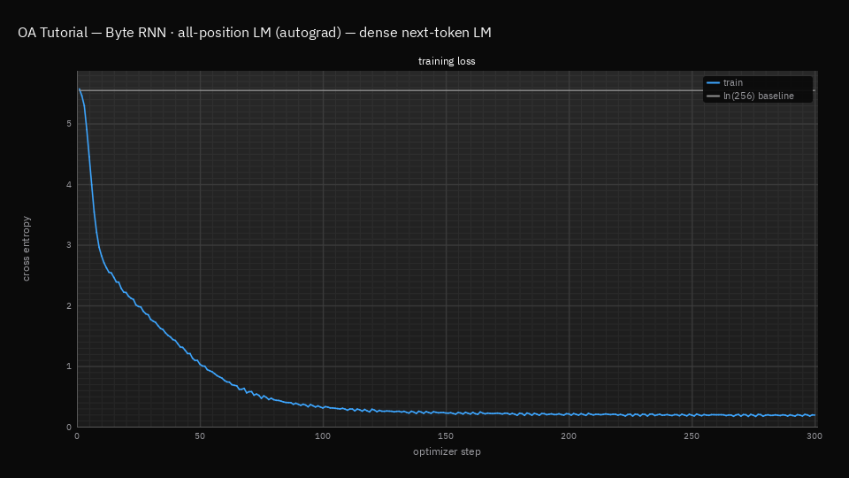

# tu_nlp_byte_rnn — Byte × RNN

The byte-tokenizer × RNN cell of the
[NLP tutorial matrix](../README.md) — same 576-character corpus, same
300-step recipe and captured training lifecycle. This entry selects
the tokenizer and model shown below. See
[`tu_nlp_char_rnn`](../tu_nlp_char_rnn/tu_nlp_char_rnn.md) for the full
walkthrough.

## This cell

| | |
| --- | --- |
| Tokenizer | the 256-token packed-U8 byte vocabulary (`ByteSampler`) — one token per source byte |
| Model | `ByteEmbedding(32) → RNN(64) → ByteHead(256)` |
| Parameters | 31,104 |
| Optimizer | AdamW(lr=0.01) — the canonical recipe |

The loop is a prepare/record pair per step — `GradientTape` → `cross_entropy` → `backward` → AdamW —
driven by `oa::ml::ItTraining`, so the whole run is one captured GPU program replayed
299 times (19 nodes for this model).

## Measured — Surface Laptop 5 (ADL GT2)



Canonical 300-step training loss, recorded by this tutorial.

| Loss init→final | Accuracy | Program nodes | Wall ms/step | Token/s |
| --- | --- | --- | --- | --- |
| 5.569→0.191 | 92.2% | 19 | 7.98 | 128.3K |

Reference generation on the default recipe (asserted by the tutorial):

```text
prompt:    "to be"
generated: "to be that is the question whether tis nobler in the mind to suffer the slings and ar"
```

## Run

```bash
cargo run --release -p sdk --example tu_nlp_byte_rnn
```

Regenerate the training-loss image from the repository root:

```bash
cargo run --release -p sdk --example tu_nlp_byte_rnn -- --plot sdk/rs/tutorials/ml/nlp/tu_nlp_byte_rnn/asset/training-curve.png
```

On the default recipe the tutorial self-tests: loss regime, accuracy
floor, exact reference generation, and `.oam` checkpoint round-trip.

## Terminal output

Recorded canonical 300-step run on Intel Iris Xe (ADL GT2), Mesa 26.2.7.
Startup logs, intermediate progress updates and the plot-save path are
omitted. Timings vary by run; these are not new benchmark baselines.

```console
╔══════════════════════════════════════════════════════════════════╗
║  OA Tutorial — Byte RNN · all-position LM (autograd)           ║
╚══════════════════════════════════════════════════════════════════╝

tokenizer: raw bytes · vocab=256
Task: dense next-byte prediction at every position

Model: ByteEmbedding(32) → RNN(64) → ByteHead(256)
params: 31104    Optimizer: AdamW(lr=0.01)


  300/300 |██████████| 2.51s · 8.37 ms/step · 7.64K sample/s · 122.31K byte token/s · 122.31K byte/s · loss: 0.1910

Summary:
  loss: initial 5.569197 · final 0.190961 · mean 0.615927
  Wall: 8.37 ms/step · 7.64K sample/s · 122.31K byte token/s · 122.31K byte/s
  GPU (byte_rnn_training_step): mean 7.135 ms/step · p50 5.531 · p95 15.493 · min 4.253 · max 18.264 · 8.97K sample/s · 143.51K byte token/s · 143.51K byte/s · wall-GPU gap 15%
  run: 2.51s · 300 steps · batch 64 · sequence 16 byte token/sample

Evaluation:
  Random-loss baseline ln(256) = 5.5452
  byte-token accuracy: 92.2%
  post-update evaluation loss: 0.186080

Generation:
  prompt: "to be"
  generated: "to be that is the question whether tis nobler in the mind to suffer the slings and ar"
program: 19 nodes · 1 recording · 299 cache hits · 0 uploads
checkpoint: optimizer step, accuracy, and exact generation restored
```

## Source

- [`tu_nlp_byte_rnn.rs`](./tu_nlp_byte_rnn.rs)
- Shared helpers: `../_byte_common.rs` / `../_bpe_common.rs` (Byte/BPE entries); Char entries are standalone
- [Suite README](../README.md)
- Python peer: [`sdk/py/tutorials/ml/nlp/tu_nlp_byte_rnn`](../../../../../py/tutorials/ml/nlp/tu_nlp_byte_rnn/tu_nlp_byte_rnn.md)
