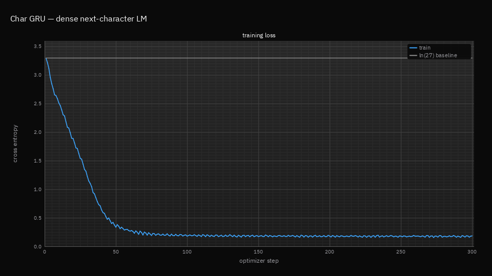

# tu_nlp_char_gru — Character × GRU

The character-tokenizer × GRU cell of the
[NLP tutorial matrix](../README.md) — same 576-character corpus, same
300-step recipe and captured training lifecycle. This entry selects
the tokenizer and model shown below. See
[`tu_nlp_char_rnn`](../tu_nlp_char_rnn/tu_nlp_char_rnn.md) for the full
walkthrough.

## This cell

| | |
| --- | --- |
| Tokenizer | the 27-token character vocabulary (`CharSampler`) — accuracy is comparable within Char rows only |
| Model | `Embedding(27,32) → GRU(64) → Linear(64,27)` |
| Parameters | 21,435 |
| Optimizer | AdamW(lr=0.01) — the canonical recipe |

The loop is a prepare/record pair per step — `GradientTape` → `cross_entropy` → `backward` → AdamW —
driven by `oa::ml::ItTraining`, so the whole run is one captured GPU program replayed
299 times (19 nodes for this model).

## Measured — Surface Laptop 5 (ADL GT2)



Canonical 300-step training loss, recorded by this tutorial.

| Loss init→final | Accuracy | Program nodes | Wall ms/step | Token/s |
| --- | --- | --- | --- | --- |
| 3.293→0.183 | 92.8% | 19 | 13.22 | 77.5K |

Reference generation on the default recipe (asserted by the tutorial):

```text
prompt:    "to be"
generated: "to be or not to be that is the question whether tis nobler in the mind to suffer the "
```

## Run

```bash
cargo run --release -p sdk --example tu_nlp_char_gru
cargo run --release -p sdk --example tu_nlp_char_gru -- --plot sdk/rs/tutorials/ml/nlp/tu_nlp_char_gru/asset/training-curve.png
```

On the default recipe the tutorial self-tests: loss regime, accuracy
floor, exact reference generation, and `.oam` checkpoint round-trip.

## Terminal output

Recorded canonical 300-step run on Intel Iris Xe (ADL GT2), Mesa 26.2.7.
Startup logs, intermediate progress updates and the plot-save path are
omitted. Timings vary by run; these are not new benchmark baselines.

```console
╔══════════════════════════════════════════════════════════════════╗
║  OA Tutorial — Char GRU · all-position LM (autograd)             ║
╚══════════════════════════════════════════════════════════════════╝

tokenizer: character · vocab=27 (a-z + space)
Task: dense next-character prediction at every position

Model: Embedding(27,32) → GRU(64) → Linear(64,27)
params: 21435    Optimizer: AdamW(lr=0.01)


  300/300 |██████████| 4.05s · 13.50 ms/step · 4.74K sample/s · 75.87K character token/s · 75.87K character/s · loss: 0.1831

Summary:
  loss: initial 3.292559 · final 0.183084 · mean 0.421002
  Wall: 13.50 ms/step · 4.74K sample/s · 75.87K character token/s · 75.87K character/s
  GPU (char_gru_training_step): mean 12.538 ms/step · p50 10.199 · p95 19.804 · min 7.872 · max 21.720 · 5.10K sample/s · 81.67K character token/s · 81.67K character/s · wall-GPU gap 7%
  run: 4.05s · 300 steps · batch 64 · sequence 16 character token/sample

Evaluation:
  Random-loss baseline ln(27) = 3.2958
  loss: evaluation 0.179721 · last training 0.183084
  character-token accuracy: 92.8%

Generation:
  prompt: "to be"
  generated: "to be or not to be that is the question whether tis nobler in the mind to suffer the "
program: 19 nodes · 1 recording · 299 cache hits · 0 uploads
```

## Source

- [`tu_nlp_char_gru.rs`](./tu_nlp_char_gru.rs)
- Shared helpers: `../_byte_common.rs` / `../_bpe_common.rs` (Byte/BPE entries); Char entries are standalone
- [Suite README](../README.md)
- Python peer: [`sdk/py/tutorials/ml/nlp/tu_nlp_char_gru`](../../../../../py/tutorials/ml/nlp/tu_nlp_char_gru/tu_nlp_char_gru.md)
