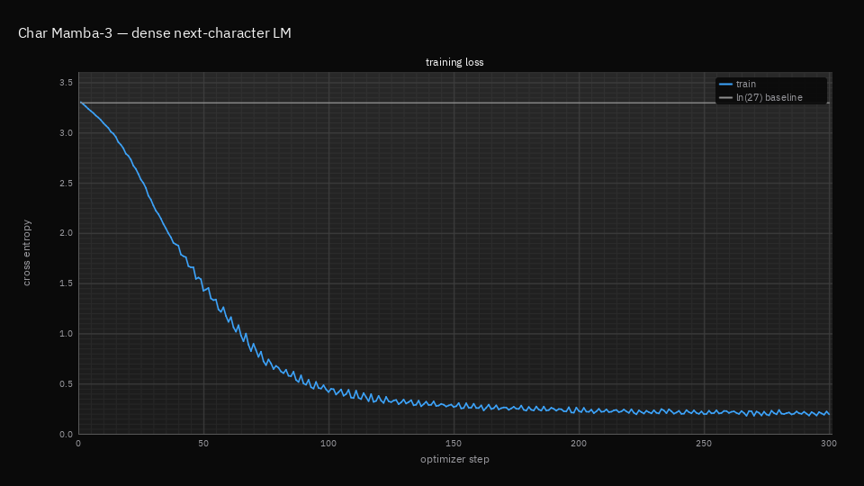

# tu_nlp_char_mamba3 — Character × Mamba-3

The character-tokenizer × Mamba-3 cell of the
[NLP tutorial matrix](../README.md) — same 576-character corpus, same
300-step recipe and captured training lifecycle. This entry selects
the tokenizer and model shown below. See
[`tu_nlp_char_rnn`](../tu_nlp_char_rnn/tu_nlp_char_rnn.md) for the full
walkthrough.

## This cell

| | |
| --- | --- |
| Tokenizer | the 27-token character vocabulary (`CharSampler`) — accuracy is comparable within Char rows only |
| Model | `Embedding(32) → Mamba-3 SISO → residual → Linear(27)` |
| Parameters | 10,915 |
| Optimizer | AdamW(lr=0.003) — lower rate for the Mamba-3/Empyrealm family |

The loop is a prepare/record pair per step — `GradientTape` → `cross_entropy` → `backward` → AdamW —
driven by `oa::ml::ItTraining`, so the whole run is one captured GPU program replayed
299 times (34 nodes for this model).

## Measured — Surface Laptop 5 (ADL GT2)



Canonical 300-step training loss, recorded by this tutorial.

| Loss init→final | Accuracy | Program nodes | Wall ms/step | Token/s |
| --- | --- | --- | --- | --- |
| 3.303→0.195 | 93.0% | 34 | 10.69 | 95.8K |

Reference generation on the default recipe (asserted by the tutorial):

```text
prompt:    "to be"
generated: "to be that is the question whether tis nobler in the mind to suffer the slings and ar"
```

## Run

```bash
cargo run --release -p sdk --example tu_nlp_char_mamba3
cargo run --release -p sdk --example tu_nlp_char_mamba3 -- --plot sdk/rs/tutorials/ml/nlp/tu_nlp_char_mamba3/asset/training-curve.png
```

On the default recipe the tutorial self-tests: loss regime, accuracy
floor, exact reference generation, and `.oam` checkpoint round-trip.

## Terminal output

Recorded canonical 300-step run on Intel Iris Xe (ADL GT2), Mesa 26.2.7.
Startup logs, intermediate progress updates and the plot-save path are
omitted. Timings vary by run; these are not new benchmark baselines.

```console
╔══════════════════════════════════════════════════════════════════╗
║  OA Tutorial — Char Mamba-3 · all-position LM (autograd)         ║
╚══════════════════════════════════════════════════════════════════╝

tokenizer: character · vocab=27 (a-z + space)
Task: dense next-character prediction at every position

Model: Embedding(32) → Mamba-3 SISO → residual → Linear(27)
params: 10915    Optimizer: AdamW(lr=0.003)

training: 300 steps · batch=64 · sequence=16 character tokens

  300/300 |██████████| 3.18s · 10.58 ms/step · 6.05K sample/s · 96.74K token/s · loss: 0.1945

Summary:
  loss: initial 3.303064 · final 0.194512 · mean 0.714765
  Wall: 10.59 ms/step · 6.05K sample/s · 96.74K token/s
  GPU (char_mamba3_training_step): mean 9.616 ms/step · p50 7.558 · p95 16.954 · min 6.281 · max 20.094 · 6.66K sample/s · 106.49K token/s · wall-GPU gap 9%
  run: 3.18s · 300 steps · batch 64 · sequence 16 token/sample

Evaluation:
  Random-loss baseline ln(27) = 3.2958
  loss: evaluation 0.190578 · last training 0.194512
  character-token accuracy: 93.0% (compare within Char only)

Generation:
  prompt: "to be"
  generated: "to be that is the question whether tis nobler in the mind to suffer the slings and ar"
program: 34 nodes · 1 recording · 299 cache hits · 0 uploads
```

## Source

- [`tu_nlp_char_mamba3.rs`](./tu_nlp_char_mamba3.rs)
- Shared helpers: `../_byte_common.rs` / `../_bpe_common.rs` (Byte/BPE entries); Char entries are standalone
- [Suite README](../README.md)
- Python peer: [`sdk/py/tutorials/ml/nlp/tu_nlp_char_mamba3`](../../../../../py/tutorials/ml/nlp/tu_nlp_char_mamba3/tu_nlp_char_mamba3.md)
