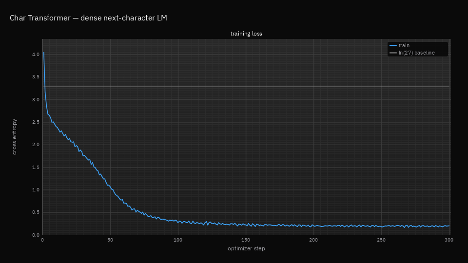

# tu_nlp_char_transformer — Character × Transformer

The character-tokenizer × Transformer cell of the
[NLP tutorial matrix](../README.md) — same 576-character corpus, same
300-step recipe and captured training lifecycle. This entry selects
the tokenizer and model shown below. See
[`tu_nlp_char_rnn`](../tu_nlp_char_rnn/tu_nlp_char_rnn.md) for the full
walkthrough.

## This cell

| | |
| --- | --- |
| Tokenizer | the 27-token character vocabulary (`CharSampler`) — accuracy is comparable within Char rows only |
| Model | `token+position embedding → TransformerBlock → LayerNorm → Linear` |
| Parameters | 10,875 |
| Optimizer | AdamW(lr=0.01) — the canonical recipe |

The loop is a prepare/record pair per step — `GradientTape` → `cross_entropy` → `backward` → AdamW —
driven by `oa::ml::ItTraining`, so the whole run is one captured GPU program replayed
299 times (44 nodes for this model).

## Measured — Surface Laptop 5 (ADL GT2)



Canonical 300-step training loss, recorded by this tutorial.

| Loss init→final | Accuracy | Program nodes | Wall ms/step | Token/s |
| --- | --- | --- | --- | --- |
| 4.041→0.200 | 92.4% | 44 | 5.95 | 172.2K |

Reference generation on the default recipe (asserted by the tutorial):

```text
prompt:    "to be"
generated: "to be or not to be that is the question whether tis nobler in the mind to suffer the "
```

## Run

```bash
cargo run --release -p sdk --example tu_nlp_char_transformer
cargo run --release -p sdk --example tu_nlp_char_transformer -- --plot sdk/rs/tutorials/ml/nlp/tu_nlp_char_transformer/asset/training-curve.png
```

On the default recipe the tutorial self-tests: loss regime, accuracy
floor, exact reference generation, and `.oam` checkpoint round-trip.

## Terminal output

Recorded canonical 300-step run on Intel Iris Xe (ADL GT2), Mesa 26.2.7.
Startup logs, intermediate progress updates and the plot-save path are
omitted. Timings vary by run; these are not new benchmark baselines.

```console
╔══════════════════════════════════════════════════════════════════╗
║  OA Tutorial — Char Transformer · all-position LM (autograd)     ║
╚══════════════════════════════════════════════════════════════════╝

tokenizer: character · vocab=27 (a-z + space)
Task: dense next-character prediction at every position

Model: token+position embedding → TransformerBlock → LayerNorm → Linear
params: 10875    Optimizer: AdamW(lr=0.01)

training: 300 steps · batch=64 · sequence=16 character tokens

  300/300 |██████████| 1.51s · 5.02 ms/step · 12.75K sample/s · 203.99K token/s · loss: 0.1996

Summary:
  loss: initial 4.040804 · final 0.199638 · mean 0.553579
  Wall: 5.02 ms/step · 12.75K sample/s · 203.97K token/s
  GPU (char_transformer_training_step): mean 4.236 ms/step · p50 3.155 · p95 10.618 · min 2.949 · max 12.600 · 15.11K sample/s · 241.71K token/s · wall-GPU gap 16%
  run: 1.51s · 300 steps · batch 64 · sequence 16 token/sample

Evaluation:
  Random-loss baseline ln(27) = 3.2958
  loss: evaluation 0.193185 · last training 0.199638
  character-token accuracy: 92.4% (compare within Char only)

Generation:
  prompt: "to be"
  generated: "to be or not to be that is the question whether tis nobler in the mind to suffer the "
program: 44 nodes · 1 recording · 299 cache hits · 0 uploads
```

## Source

- [`tu_nlp_char_transformer.rs`](./tu_nlp_char_transformer.rs)
- Shared helpers: `../_byte_common.rs` / `../_bpe_common.rs` (Byte/BPE entries); Char entries are standalone
- [Suite README](../README.md)
- Python peer: [`sdk/py/tutorials/ml/nlp/tu_nlp_char_transformer`](../../../../../py/tutorials/ml/nlp/tu_nlp_char_transformer/tu_nlp_char_transformer.md)
