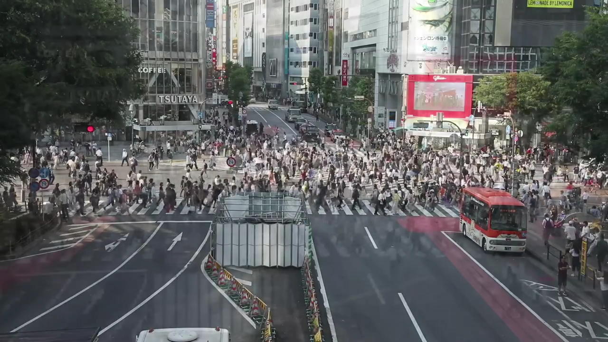

# tu_viewer_video — Native GPU video playback

Play an H.264, H.265, VP9, or AV1 file end to end: OA's own demuxer and
codec parsers feed Vulkan Video decode sessions, and the decoded frames
are presented through the GPU pipeline — no external codec library is
linked anywhere in the path.



*Frame 30 of the bundled Shibuya fixture, decoded by OA and written to PNG
by this tutorial's `--poster` mode.*

## What this tutorial covers

- **Level 0** — `oa::Viewer` in `ViewerMode::Video`: one config struct, one
  call, a complete player window.
- **Level 1** — `oa::video::VideoPlayer`: the session API underneath,
  used here to capture a decoded frame headlessly and save it.
- The codec/profile/bit-depth matrix the native path qualifies, and how
  unsupported profiles fail.

## How a packet becomes a pixel

Every stage below is OA code running inside one `Engine`:

| Stage | Owner | What it does |
|---|---|---|
| Container demux | `oa::video::VideoDemuxer` | MP4/MKV/TS packetization; codec + stream metadata |
| Bitstream parse | `oa::video::{h264, h265, av1, vp9}` | SPS/PPS/slice/frame-header parsing against the specs |
| Decode session | `oa::runtime` device video | Vulkan Video session, std parameter objects, DPB/reference management |
| Presentation | `cvt_yuv420_to_rgba8` Slang kernel | On-device YUV→RGBA conversion honoring matrix/range metadata |
| Display | `oa::Viewer` video mode | Timeline, scrub bar, and the GPU blit to the swapchain |

Decoded planes stay on the device the whole way. A decoded frame is a
lease-protected DPB slot — presentation converts it into a `Texture` and
releases the lease so the decoder can recycle the slot.

## Qualified codec matrix (Intel ADL GT2 / Mesa ANV)

The checked-in fixture set in `sdk/asset/video/clip/` covers every admitted
decode profile — one shibuya 720p30 source re-encoded per profile:

| Codec | Decode | Encode |
|---|---|---|
| H.264 | Baseline, Main, High — 8-bit 4:2:0 | High — 8-bit |
| H.265 | Main, Main10 (10-bit) | Main — 8-bit, Main10 + REx — 10-bit |
| VP9 | Profile 0 — 8-bit, Profile 2 — 10-bit | — |
| AV1 | Main — 8-bit and 10-bit 4:2:0 | — |

Profiles the device does not expose (H.264 High10, 12-bit variants) are
rejected by an exact capability query with `MissingCapability` — the API
fails closed rather than pretending to decode.

## Walkthrough

### Level 0: the whole player

`ViewerConfig` selects `ViewerMode::Video`, a media path, and a window
title. `run_standalone` owns the window, the timeline, input handling, and
the render loop:

```rust
let config = ViewerConfig {
	mode: ViewerMode::Video,
	path: path.to_owned(),
	title: title.to_owned(),
	loop_media: false,
	..ViewerConfig::default()
};

Viewer::new(config).run_standalone()
```

That is the entire application — the viewer composes the demuxer, player,
presentation, and blit internally.

### Level 1: capturing a frame

`--poster` uses the session API directly. `VideoPlayer::new_native` opens
the container and the native decoder, keeping decoded planes on the GPU:

```rust
let mut player = VideoPlayer::new_native(
	&engine,
	std::path::Path::new(input),
	VideoPlayerConfig {
		start_playing: false,
		loop_playback: false,
		..VideoPlayerConfig::default()
	},
)?;
player.seek_frame(frame)?;
let texture = player.current_frame_texture()?;
```

`seek_frame` positions the decode cursor; `current_frame_texture`
converts the current native frame into an RGBA `Texture` and — the
important part — *re-seats* the presented frame on the texture, so the
decoder slot underneath is freed for reuse.

From there the frame is ordinary image data:

```rust
let rgba = texture.read_rgba8()?;
oa::image::save_rgba_file(&rgba, width, height, output, 90)?;
```

`asset/poster-frame.png` in this directory was produced by exactly this
path — OA decode, OA presentation, OA PNG encode.

## Run

```bash
# default fixture (H.264 High)
cargo run -p sdk --release --example tu_viewer_video

# any supported clip
cargo run -p sdk --release --example tu_viewer_video -- <file.mp4>

# headless poster capture of frame 30
cargo run -p sdk --release --example tu_viewer_video -- \
	sdk/asset/video/clip/shibuya_720p_30fps_h264_high_8bit_420.mp4 \
	--poster asset/poster-frame.png --frame 30
```

Controls: `Space` play/pause, arrow keys step/seek, `+/-` zoom, `0` fit,
`Q`/`Esc` quit.

## Assets

- [`asset/poster-frame.png`](asset/poster-frame.png) — tutorial-local,
  generated by `--poster` (regenerate with the command above).
- `sdk/asset/video/clip/shibuya_720p_30fps_*.mp4` — shared fixture set,
  kept at the repo asset root because many tests, benchmarks, and
  tutorials consume the same clips.

## Where to go next

- `tu_viewer_image` — the same level-0 Viewer for still images.
- `tu_viewer_image_headless` — headless render/sink without a window.
- `tu_audio_commands` — media + ML end to end.
